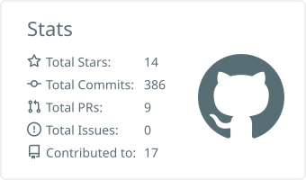
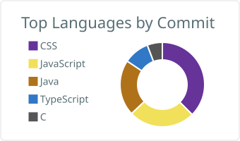

  

  

  
  
  

<!-- ⚠️ Troque SEU_USUARIO pelo seu username do GitHub nos 2 links abaixo -->

  

  

<h3 align="center">// github stats</h3>

  
  

  

  🔗 <a href="https://portifolio-thiago-sousa.vercel.app/">Portfólio</a>
  •
  <a href="https://www.linkedin.com/in/tpsousa-/">LinkedIn</a>
  •
  <a href="mailto:tpsousa.eng@gmail.com">tpsousa.eng@gmail.com</a>

